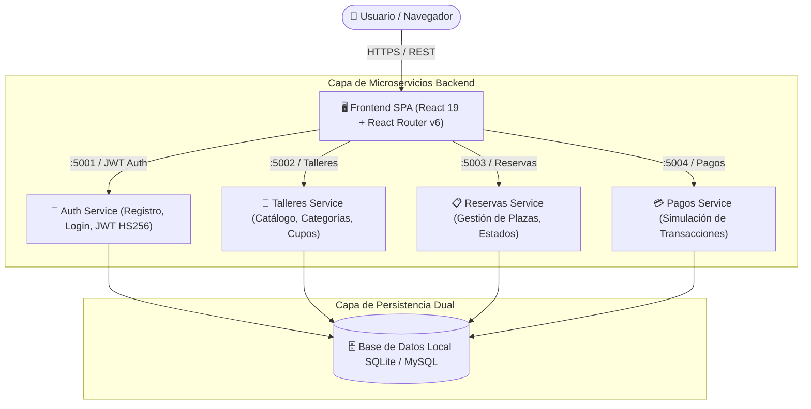

# 🍳 MasterCook Academy

> **Plataforma Integral de Gestión y Reserva de Talleres Culinarios**  
> Diseñada con arquitectura de microservicios orientada a eventos, frontend SPA reactivo y compatibilidad dual para despliegues en la nube (Google Cloud Run) y desarrollo local (SQLite / Docker).

[](https://react.dev/)
[](https://flask.palletsprojects.com/)
[](https://www.docker.com/)
[](https://www.python.org/)
[](https://www.mysql.com/)
[](LICENSE)

---

## 📌 Visión General del Proyecto

**MasterCook Academy** es una solución integral full-stack para escuelas gastronómicas. Permite a los usuarios descubrir talleres culinarios especializados (Cocina Internacional, Repostería Creativa, Alimentación Saludable), reservar plazas en tiempo real con validación estricta de aforos y completar transacciones mediante simulación de pagos.

El proyecto destaca por su desacoplamiento funcional: un frontend moderno en React que interactúa con cuatro microservicios independientes en Flask, cada uno con responsabilidad única y ciclo de vida autónomo.

---

## 🏗️ Arquitectura del Sistema



---

## 🚀 Características Destacadas

- 🔐 **Autenticación y Seguridad JWT**: Registro con hash seguro de contraseñas (Werkzeug pbkdf2), emisión de tokens JWT y rutas frontend protegidas con persistencia controlada.
- 🍲 **Catálogo y Filtrado Dinámico**: Exploración de talleres con filtrado reactivo por categorías, estados de carga con *Skeleton screens* y validación dinámica de cupos disponibles.
- 📋 **Control de Aforo y Reservas**: Lógica concurrente para asegurar que no se exceda la capacidad del taller al formalizar reservas.
- 💳 **Simulación y Procesamiento de Pagos**: Flujo guiado de confirmación de pago conectado con actualización de estado de la reserva.
- 📱 **Diseño Responsivo e Inmersivo**: Interfaz fluida adaptable a móviles y escritorio, con fondo de video optimizado y temas visuales coherentes.
- 🧪 **Alta Cobertura de Pruebas**: Suite de pruebas unitarias y de integración para componentes React (`@testing-library/react`) y suite de pruebas para los microservicios backend.

---

## 🛠️ Stack Tecnológico

### Frontend
- **Framework:** React 19 SPA
- **Enrutamiento:** React Router v6
- **Iconografía:** FontAwesome 6
- **Estilos:** CSS3 nativo con diseño responsivo (Flexbox / CSS Grid / Skeletons)
- **Testing:** Jest + React Testing Library

### Backend (Microservicios)
- **Lenguaje:** Python 3.9+
- **Framework Web:** Flask 3.1 con Flask-CORS
- **ORM / Persistencia:** Flask-SQLAlchemy 3.1 & SQLAlchemy 2.0
- **Seguridad:** PyJWT, Werkzeug security
- **Bases de Datos Compatibles:** SQLite (entorno local sin dependencias) y MySQL 8.0 (entornos Docker / Cloud)

### DevOps & Despliegue
- **Contenedores:** Docker & Docker Compose con healthchecks para orquestación de bases de datos
- **Nube:** Diseñado para Google Cloud Run (contenedores serverless sin estado)

---

## ⚙️ Decisiones de Ingeniería Destacadas

1. **Estrategia de Base de Datos Dual (Zero-Friction Dev Experience)**:  
   Para facilitar la evaluación inmediata del proyecto sin obligar a instalar y configurar un servidor MySQL, los microservicios autodetectan el entorno y utilizan SQLite (`mastercook.db`) de forma transparente en desarrollo local, manteniendo compatibilidad total con MySQL para producción.
2. **Cliente API Centralizado y Desacoplado**:  
   Toda la comunicación externa se abstrae en [`src/services/api.js`](frontend/src/services/api.js), lo que permite alternar entre URLs locales y los endpoints en Google Cloud Run mediante un único archivo de configuración (`.env`).
3. **Manejo Robusto de Concurrencia en Reservas**:  
   El microservicio de reservas valida la capacidad máxima y actualiza automáticamente la disponibilidad del taller al llenarse.

---

## 💻 Puesta en Marcha en Local

### Prerrequisitos
- **Node.js** (v18 o superior) y **npm**
- **Python** (v3.9 o superior)
- *(Opcional)* **Docker** y **Docker Compose**

---

### Opción 1: Ejecución Rápida en Local (Recomendada)

#### 1. Iniciar los 4 Microservicios Backend
```bash
# Desde la raíz del proyecto
python3 -m venv backend/.venv
backend/.venv/bin/pip install Flask Flask-SQLAlchemy Flask-Cors python-dotenv Werkzeug PyJWT mysql-connector-python

# Sembrar datos iniciales y arrancar microservicios
backend/.venv/bin/python backend/run_local.py
```
> Esto inicializa la base de datos con talleres de muestra, categorías y el usuario demo, levantando los puertos `5001`, `5002`, `5003` y `5004`.

#### 2. Iniciar el Frontend
En otra terminal:
```bash
cd frontend
npm install
npm start
```
La aplicación estará disponible en [http://localhost:3000](http://localhost:3000).

---

### Opción 2: Ejecución mediante Docker Compose

```bash
cd backend
docker compose up --build
```
> Levanta un contenedor MySQL 8.0 junto con los 4 contenedores de los microservicios.

---

## 🔑 Credenciales de Prueba

| Rol | Correo Electrónico | Contraseña |
| :--- | :--- | :--- |
| **Usuario Demo** | `admin@test.com` | `admin12345` |

*(También puedes registrar un usuario nuevo directamente desde la pantalla de Registro).*

---

## 🧪 Pruebas Automatizadas

### Pruebas de Frontend (Jest + React Testing Library)
```bash
cd frontend
CI=true npm test -- --watchAll=false
```
Verifica renderizado de componentes, validaciones de formularios (mínimo 8 caracteres en contraseña), tarjetas de talleres con precios formateados y vistas de pago y reservas.

### Pruebas de Integración Backend
Con los microservicios activos:
```bash
python3 backend/tests/test_local_flow.py
```
Verifica el ciclo completo: autenticación JWT, listado de talleres, detalle, reserva, simulación de pago y consulta de reservas de usuario.

---

## 📁 Estructura del Repositorio

```
MasterCook/
├── backend/
│   ├── auth/              # Microservicio de Autenticación (Puerto 5001)
│   ├── talleres/          # Microservicio de Talleres Culinarios (Puerto 5002)
│   ├── reservas/          # Microservicio de Gestión de Reservas (Puerto 5003)
│   ├── pagos/             # Microservicio de Pagos Simulados (Puerto 5004)
│   ├── tests/             # Tests de integración backend
│   ├── docker-compose.yml # Orquestación Docker con MySQL 8.0
│   ├── seed.py            # Sembrador de datos iniciales
│   └── run_local.py       # Orquestador de microservicios para local
├── frontend/
│   ├── public/            # HTML base y assets públicos
│   └── src/
│       ├── components/    # Componentes UI (Navbar, AuthForm, WorkshopCard...)
│       ├── context/       # AuthContext (Gestión de sesión JWT)
│       ├── pages/         # Vistas (Talleres, Detalle, Pago, MisReservas, Dashboard)
│       ├── services/      # Cliente centralizado api.js
│       ├── App.js         # Enrutamiento de la SPA
│       └── App.test.js    # Suite de pruebas automatizadas
├── .gitignore             # Exclusiones de dependencias y entornos
└── README.md              # Documentación principal
```

---

## 👨‍💻 Autor y Contacto

Proyecto desarrollado como demostración técnica full-stack y arquitectura de microservicios.  
- **Desarrollador:** Ishai FL
- **Tecnologías:** React, Python/Flask, Microservicios, Docker, SQL
